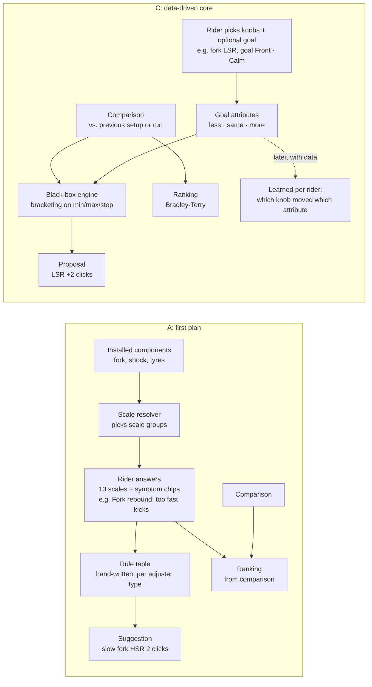
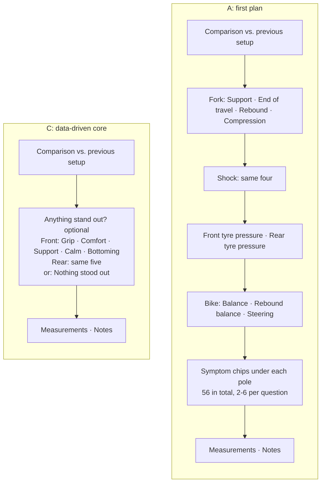
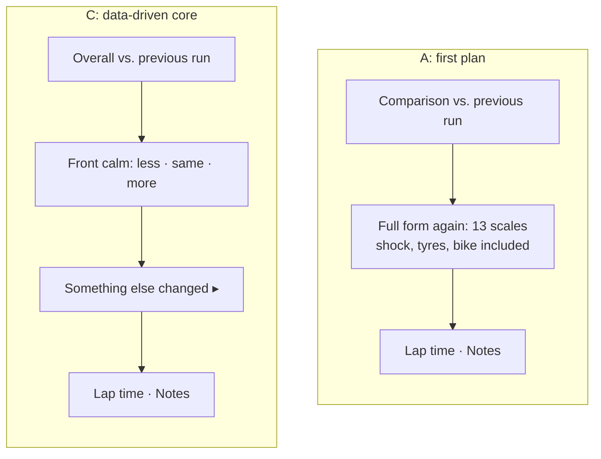

# Feedback approaches compared (issue #85, Phase 0 discussion)

Drafted: 2026-10-22. Decision: **C** (maintainer, 2026-10-22).

| | Approach | Where it comes from |
|---|---|---|
| **A** | Per-component "just right" scales + symptom chips + hand-written rule table | First plan, first Phase 0 vocabulary draft (issue comment, superseded) |
| **B** | Per-end feel attributes + "where?" situations + hand-written knob → attribute map | Intermediate idea from the review discussion |
| **C** | Data-driven core: comparison + optional per-end attributes; the rider picks knobs and goal; black-box engine | Recommended (`scenarios.md`) |

B is listed so the step from A to C is visible. The comparison below
focuses on **A vs. C**.

## Where domain knowledge lives

In A, the app's own tables interpret the rider's answers. In C, the rider gives
the meaning (which knobs, which goal), and the engine only sees "better or
worse".

## Same bike, same moment

Full-suspension bike: fork and shock with pressure + LSC/HSC/LSR/HSR, two tyres
on wheels.

### Everyday ride after a setup change

### Test-session run (tuning fork LSR, goal "Front · Calm")

## Side by side

| Topic | A: first plan | C: data-driven core |
|---|---|---|
| Rider is asked | Diagnosis per component ("rebound too fast") | Perception per end of the bike ("front not calm") plus better/worse |
| Questions, everyday (full-sus, 2 tyres) | up to 14 (1 comparison + 13 scales) | 1 comparison + follow-ups on the reference's open issues + 10 optional flags |
| Symptom chips | 56 | none (attributes are the chips) |
| Questions, session run | up to 14 (the form isn't narrowed) | 1 comparison + goal attributes (1-3) + lap time |
| Depends on installed components | yes (scale resolver, tyre position) | no: same form for every bike |
| Works for custom/rider/bike-level adjustments | only through notes | yes: any adjustment can be a session knob |
| Domain research | large: scales, 56 symptoms, 15 rules, partly unsourced | small: attribute wording, session goal |
| Choosing which knob to test | rule table suggests it | rider chooses (beginner helper possible later) |
| Suggestion outside a session | rule-based, immediate | none in v1; open issues only |
| Risk of wrong advice | real (rules can be wrong) | low (repeats the rider's own preference) |
| Data for analysis / ML | rich but in the app's interpretation | sparser, in the rider's own terms, plus clean pairwise comparisons |
| "Dialled in" | all scales = 0 | "Nothing stood out" |
| Locking a knob in a session | not defined | converged bracketing or the rider's Lock button |

## Stored keys

Same tables in both (`Feedbacks`, `FeedbackObservations`, `FeedbackComparisons`,
`Measurements`, `TestSessions`). Only the observation keys differ.

| Meaning | A | C |
|---|---|---|
| Scale / attribute (everyday) | `scale.fork.rebound` = −2 … +2 | `issue.front.calm` = 1 (flagged) |
| Symptom | `symptom.fork.kicks` = 1 | (none) |
| Tyre | `scale.tire.front.pressure` = −2 … +2 | covered by `issue.front.grip`, `issue.front.comfort` |
| Relative to the reference setup | (none) | comparison row, aspect `front.calm`, outcome −1 / 0 / +1 |
| Custom measurement | `custom:<id>` | `custom:<id>` |

## Effect on the plan

| Phase | A | C |
|---|---|---|
| 0 Research | scales, 56 symptoms, rule table | attribute wording, goal, "Nothing stood out" |
| 2 Models | vocabulary + `FeedbackScaleResolver` | small attribute vocabulary, no resolver |
| 6 Form | component scale groups, chips | comparison + attribute flags, session variant |
| 10 Test sessions | runs, banner | + optional goal, Lock per knob |
| 11 Engine | bracketing | bracketing (unchanged) |
| 12 Suggestions | rule table | follow-up: beginner helper, or a learned map once data exists |

## What C gives up

- **Immediate advice for beginners.** A says "slow fork HSR"; C only says
  "front not calm" until the rider runs a session. A beginner helper (goal →
  which knob to try) can be added later without touching the core.
- **Detail per component.** A tells fork rebound and front tyre pressure apart in
  one ride; C can't from feel alone. C tells them apart by testing one knob at a
  time, which is also how tuners do it.
- **Rich labels for analysis.** A stores the app's interpretation in every
  feedback. C stores less per ride but in the rider's own terms, which is
  closer to what was actually felt.
