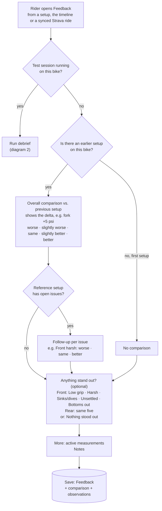
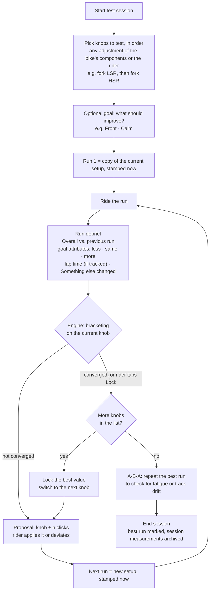
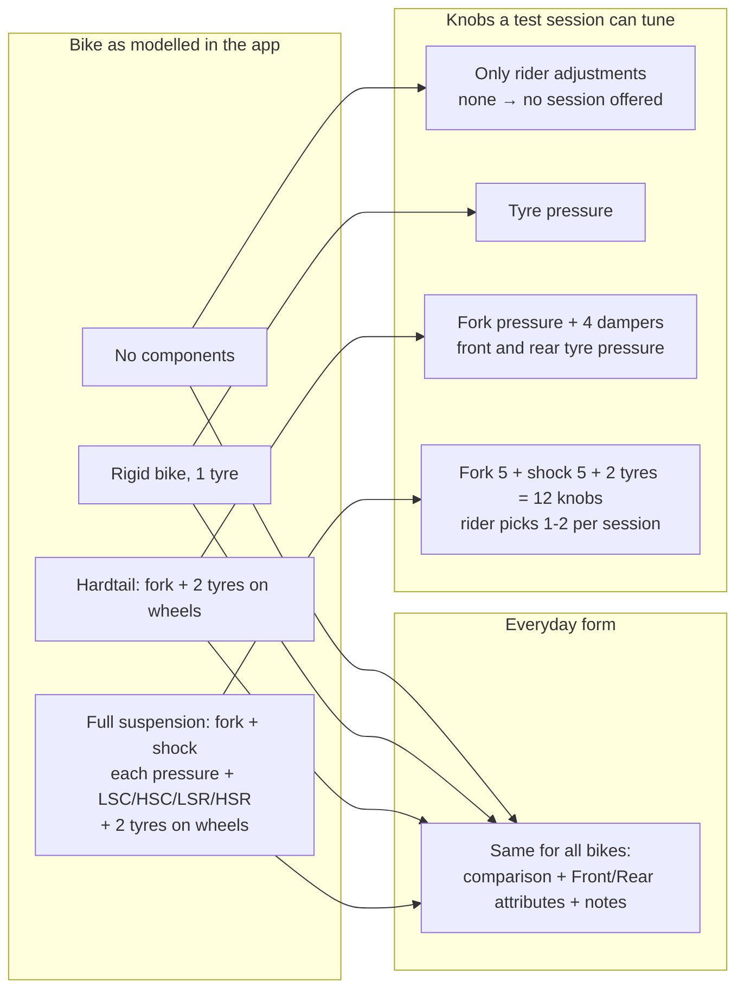

# Feedback scenarios (issue #85, Phase 0 discussion)

Drafted: 2026-10-22. Approach C chosen (`comparison.md`); vocabulary in
`vocabulary.md`.

Shows the **data-driven core** direction: the feedback form asks for the overall
comparison plus optional feel attributes per end of the bike. Components only
decide which knobs a test session can tune. Differences from the first plan
are listed at the end.

## 1. Everyday feedback (no test session)

The same comparison rows feed the setup ranking (Bradley-Terry). Attribute
flags become the "open issues" shown on the setup (*Front: comfort*), and
"Nothing stood out" shows **Dialled in**.

## 2. Test session

## 3. Bike configurations

## User stories

| # | Story | Form | What the engine does |
|---|---|---|---|
| 1 | Synced Strava ride, setup unchanged since the last feedback | Comparison vs. previous setup again (optional), follow-ups, attributes, notes | Another ranking edge for the same pair; flags update open issues |
| 2 | First ride after changing fork pressure +5 psi | Comparison vs. previous setup with "fork +5 psi" shown | One ranking edge: new setup vs. previous |
| 3 | First feedback on a new bike | No comparison, attributes, notes | No ranking yet |
| 4 | Several rides on the same setup, different trails | One feedback per ride, all resolve to the same setup | Comparisons on each count for that setup |
| 5 | Session, one knob (fork LSR), 6 runs | Run debrief: comparison vs. previous run, goal attributes, lap time | Bracketing proposes the next clicks, A-B-A at the end |
| 6 | Session, two knobs (fork LSR then HSR) | Same; the goal attributes may stay the same | LSR is locked when converged (or by the rider), then HSR is bracketed |
| 7 | Rigid bike or bike without components | Same everyday form as any bike | Session only if there is something adjustable (tyre, rider) |
| 8 | Setup inserted afterwards between setup and feedback | Feedback shows the drift warning with Relink | Ranking edge moves to the inserted setup |

## Changes versus the first plan

- Per-component scales (`scale.fork.rebound`, …) and `FeedbackScaleResolver` are
  replaced by per-end feel attributes. The form no longer depends on the
  installed components.
- Test sessions get an optional **goal** (attributes to improve) and a **Lock**
  action per knob.
- The hand-written symptom/attribute → adjuster rule table (Phase 12) moves to an
  optional follow-up: a beginner helper that suggests which knob to put into a
  session.
